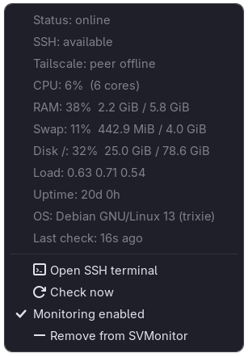

# SVMonitor

**Theo dõi Linux server ngay từ system tray — dùng SSH Config sẵn có, không cần agent.**

SVMonitor dành cho người dùng Linux quản lý một hay nhiều máy chủ qua SSH: xem nhanh tài nguyên,
nhận thông báo khi kết nối có vấn đề và mở terminal SSH mà không phải rời desktop.
Ứng dụng viết bằng Rust, không Electron, WebView hay bộ giao diện nặng.

> **v0.1.1** · Mã nguồn mở theo MIT · Đã sử dụng và kiểm thử trên CachyOS, GNOME 51, Wayland.

## Có gì nổi bật?

- **System tray:** tổng quan nhiều server, submenu xem thông số và bật/tắt monitoring độc lập.
- **Tận dụng OpenSSH:** khám phá alias trong `~/.ssh/config`, tái sử dụng SSH key, ssh-agent,
  port, `Include` và `ProxyJump`. Không ghi đè SSH Config, không lưu mật khẩu hay nội dung khóa.
- **Metrics không cần agent:** CPU, RAM, swap, disk, uptime và load average qua một script chỉ đọc.
  Không cài dịch vụ lên server, không dùng `sudo`.
- **Tách bạch tình trạng:** Tailscale, khả năng kết nối SSH và sức khỏe server được hiển thị riêng.
  Tailscale báo peer offline không tự động có nghĩa là SSH không truy cập được.
- **Thông báo có kiểm soát:** xác nhận lỗi qua nhiều lần kiểm tra, retry/backoff, cooldown và hạn chế
  cảnh báo khi mạng cục bộ gặp sự cố.
- **Quick SSH:** mở terminal mặc định qua `xdg-terminal-exec`, hoặc chọn terminal riêng cho SVMonitor.
- **Lịch sử, autostart và CLI:** vẫn dùng được khi desktop không có khay hệ thống.

## Giao diện thực tế

<p align="center">
  
</p>

Ảnh chụp submenu **đang chạy với metrics thật** trên CachyOS. Để không đưa tên máy chủ và nội dung
màn hình cá nhân lên mạng, ảnh chỉ lấy vùng submenu; menu D-Bus của ứng dụng được hiển thị bằng
host GTK/libdbusmenu để chụp. Giao diện popup của GNOME/KDE có thể khác theo theme.
Không dựng lại thông số hoặc tạo dữ liệu minh họa.

## Cài đặt

Hiện repository cung cấp **mã nguồn và script đóng gói**, chưa có GitHub Release hay kho gói riêng.
Clone trước khi làm theo các bước bên dưới:

```sh
git clone https://github.com/MinhCYB/SVMonitor.git
cd SVMonitor
```

### Arch Linux / CachyOS

Cần bộ công cụ build (`base-devel`) và Rust/Cargo đủ mới; xem [build từ source](#build-từ-source).

```sh
cd packaging/arch
makepkg -si
```

Gói dùng OpenSSH client; `xdg-terminal-exec` là dependency tùy chọn để mở đúng terminal mặc định.
Trên GNOME, cài và bật extension **AppIndicator and KStatusNotifierItem Support** để thấy tray:

```sh
sudo pacman -S xdg-terminal-exec gnome-shell-extension-appindicator
```

### Debian 12 / 13

Build gói trong container Debian 12 giúp giữ nền glibc phù hợp. Cần Docker hoạt động và quyền chạy
Docker của tài khoản hiện tại; script tải toolchain và dependency build bên trong container.

```sh
mkdir -p dist
./packaging/debian/docker-build.sh
sudo apt install ./dist/svmonitor_0.1.1_amd64.deb
```

Đã kiểm thử cài đặt/gỡ gói và xử lý reload trong container Debian 12 và 13. Desktop Debian chưa
được thử trực tiếp. Nếu distro có `xdg-terminal-exec`, nên cài thêm; nếu không, SVMonitor hỗ trợ
`x-terminal-emulator` hoặc cấu hình terminal riêng. GNOME cần extension AppIndicator tương tự Arch.

## Bắt đầu trong vài phút

Giả sử bạn đã có alias `my-server` trong SSH Config và đăng nhập được bằng `ssh my-server`:

```sh
svmonitor discover              # Liệt kê các SSH Host alias
svmonitor import my-server      # Chọn alias để giám sát
svmonitor check                 # Kiểm tra ngay, chỉ đọc trên server
svmonitor run                   # Chạy tray và monitoring
```

Có thể chọn alias ngay trong menu **Add from SSH config**. Để khởi động cùng desktop:

```sh
svmonitor autostart enable
```

Hoặc dùng user service được gói cài đặt cung cấp:

```sh
systemctl --user enable --now svmonitor.service
```

Chọn **một** cơ chế autostart để tránh gọi ứng dụng hai lần. SVMonitor có khóa single-instance.

### Cấu hình monitoring

File mặc định: `~/.config/svmonitor/config.toml`. CLI import sẽ tạo file nếu chưa có.
Ví dụ tối giản:

```toml
[general]
interval_secs = 60
notifications = true
terminal = ""              # Dùng terminal mặc định của desktop/user

[[server]]
name = "my-server"          # Alias trong ~/.ssh/config
enabled = true
```

Sau khi sửa file, chạy `svmonitor reload` hoặc `systemctl --user reload svmonitor.service`.
Reload áp dụng trong tiến trình đang chạy; cấu hình lỗi bị từ chối và cấu hình hợp lệ trước đó
vẫn được giữ. Thêm server chưa có alias bằng `svmonitor add lab --host 192.0.2.10 --user deploy`.

Xem [cấu hình đầy đủ](docs/config.example.toml) và [hướng dẫn sử dụng](docs/USAGE.md).

## Các lệnh CLI thường dùng

| Lệnh | Công dụng |
|---|---|
| `svmonitor status` / `status --json` | Xem trạng thái hiện tại |
| `svmonitor status -w` | Theo dõi liên tục trong terminal |
| `svmonitor run --headless` | Monitoring không cần tray |
| `svmonitor check my-server` | Probe một lần, không cần daemon |
| `svmonitor discover` / `import --all` | Khám phá / nhập SSH alias |
| `svmonitor enable my-server` / `disable my-server` | Bật/tắt giám sát |
| `svmonitor ssh my-server` | Mở terminal SSH tương tác |
| `svmonitor history my-server` | Xem lịch sử sự kiện |
| `svmonitor reload` | Nạp lại cấu hình, không khởi động lại daemon |
| `svmonitor doctor` | Kiểm tra môi trường và gửi thông báo thử |

`general.terminal = ""` ưu tiên `xdg-terminal-exec` và các thiết lập XDG của desktop/user.
Có thể đặt `terminal = "kitty"` hoặc một argv prefix có dấu nháy cho đường dẫn chứa khoảng trắng.
SVMonitor không đổi terminal mặc định của hệ thống và không ghép lệnh SSH qua shell.

## Nhẹ đến mức nào?

Số liệu **đã đo**, release build v0.1.1 trên CachyOS. CPU dưới đây gồm daemon và các tiến trình SSH con:

| Kịch bản | Thời gian đo | RSS trung bình / cao nhất | CPU tổng |
|---|---:|---:|---:|
| Tray, 1 server thật, chu kỳ 60 giây | 240 giây | 6,4 / 6,4 MiB | 0,037% |
| Tray, 2 đích không kết nối được | 120 giây | 6,3 / 6,5 MiB | 0,075% |

Soak test 330 giây, 3 server mô phỏng ở chu kỳ 5 giây: RSS 4600 → 4608 KiB,
file descriptor 6 → 6, thread 2 → 2, không có zombie process.
Các phép đo ngắn này **không thay thế kiểm thử chạy nhiều ngày**; CPU có độ phân giải theo tick.
Chi tiết và cách tái hiện: [benchmark](docs/BENCHMARKS.md).

## Build từ source

Cần Linux, OpenSSH client, C linker và **Rust/Cargo 1.89 trở lên** cho `Cargo.lock` hiện tại.

```sh
cargo build --locked --release
cargo test --locked
cargo clippy --locked --all-targets -- -D warnings
install -Dm755 target/release/svmonitor ~/.local/bin/svmonitor
```

Đảm bảo `~/.local/bin` có trong `PATH`. Build thủ công chỉ cài binary; gói Arch/Debian còn cung cấp
application entry và user service. Dùng `svmonitor autostart enable` nếu chỉ cài binary.

## Tương thích và giới hạn

- Linux là nền tảng chính; server cần POSIX `sh`, `/proc` và `df`. Không hỗ trợ metrics macOS/BSD.
- CachyOS GNOME Wayland đã thử trực tiếp; Debian 12/13 đã thử gói trong container. KDE và các
  desktop khác dùng StatusNotifierItem nhưng chưa được kiểm thử trực tiếp.
- Khóa có passphrase cần nạp vào ssh-agent. Host key mới phải được xác minh bằng SSH tương tác;
  monitoring nền không hỏi mật khẩu và không tự chấp nhận host key.
- Không có biểu đồ lịch sử trong tray hay điều khiển từ xa. Lịch sử lưu cục bộ dạng JSONL có rotation.
- Chưa xác minh aarch64, musl hoặc độ ổn định chạy liên tục nhiều ngày.

Tài liệu thêm: [sử dụng & xử lý lỗi](docs/USAGE.md) · [tương thích](docs/COMPATIBILITY.md) ·
[thiết kế](docs/design.md) · [tự review bảo mật](docs/SECURITY.md).

## Đóng góp

Issue và pull request đều được chào đón tại [GitHub](https://github.com/MinhCYB/SVMonitor).
Khi báo lỗi, hãy gửi distro/desktop, phiên bản SVMonitor và các bước tái hiện; **che hostname, IP,
username, log riêng tư và tuyệt đối không đính kèm private key/token**.

Trước khi gửi PR, chạy `cargo fmt --check`, `cargo test --locked` và clippy như trên. Ưu tiên thay đổi
nhỏ, có regression test cho lỗi hành vi, giữ chi phí RAM/CPU thấp và không viết dữ liệu lên server.
Thay đổi giao diện cần ảnh chụp thật đã kiểm tra thông tin riêng tư.

## Giấy phép

[MIT](LICENSE) — tự do sử dụng, sửa đổi và chia sẻ theo điều khoản của giấy phép.
