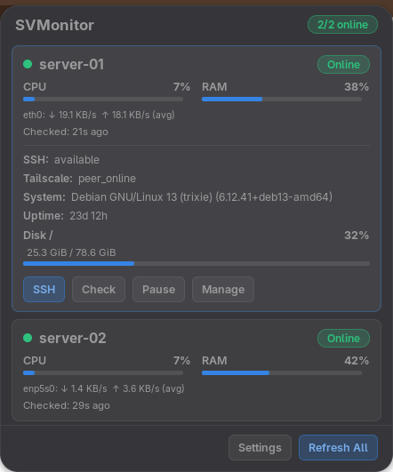
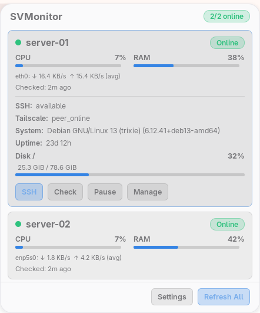

# Native GNOME 51 dashboard

Target: current CachyOS GNOME 51.1 Wayland session only. No GTK window in this path.

## Install

```sh
cargo build --release --bin svmonitor
install -m755 target/release/svmonitor ~/.local/bin/svmonitor.new
mv ~/.local/bin/svmonitor.new ~/.local/bin/svmonitor
scripts/install-gnome-extension.sh
gnome-extensions enable svmonitor@svmonitor.local
```

The native extension reads the daemon's cached `state.json`. Actions invoke the typed `svmonitor ui` CLI asynchronously; only Check/Refresh All requests a probe. Existing SSH config, keys, notifications and monitoring remain managed by Rust.

## First registration in an already-running session

GNOME 51 does not discover a new local extension UUID through EnableExtension; ReloadExtension is deprecated. Do not restart GNOME Shell or log out while other work is running.

With explicit user permission, open Looking Glass (`Alt+F2`, `lg`) and evaluate this one-time registration command:

```js
(async () => { const m = Main.extensionManager; const u = 'svmonitor@svmonitor.local'; const d = Gio.File.new_for_path(GLib.build_filenamev([GLib.get_user_data_dir(), 'gnome-shell', 'extensions', u])); if (!m.lookup(u)) { const e = m.createExtensionObject(u, d, 2); await m.loadExtension(e); } return m.enableExtension(u); })()
```

This registers only SVMonitor; it does not enable global unsafe mode or restart the Shell. Close Looking Glass with Escape. Do not repeat registration to hot-reload changed ES modules: GNOME caches imported extension code for the session.

## Rollback

```sh
gnome-extensions disable svmonitor@svmonitor.local
```

The extension destroys its panel button, cancels its own I/O/timers, and restores SVMonitor's original AppIndicator visibility. The daemon and other extensions keep running. The previous menu and optional `svmonitor-popup` remain available for rollback. No AppIndicator files or global settings are modified.

## Desktop behavior

One click opens a native panel popup. Outside click or Escape closes it. Header/footer stay fixed; only the server list scrolls. CPU/RAM are equal-width columns. Current throughput is not displayed for stale/offline data. Expanded rows expose SSH, Check, Pause/Resume and management actions. Settings opens the existing config; it does not launch a second monitoring engine.

Collapsed cards contain server/status, CPU, RAM, network and check age; Disk is never rendered there.
Expanded details add SSH/Tailscale, system, uptime and the most-used filesystem's Disk label,
used/total GiB, percentage and progress bar before the actions. Offline cards retain these last-known
values with a stale marker instead of presenting current throughput.

CPU, RAM and Disk share the same 5 px height, 3 px corner radius and horizontal LTR layout.
Fill width follows the allocated track width; 0% hides the fill and 100% fills the track.
`St.Bin` centered its child even with `x_align: START`; horizontal `St.BoxLayout` fixes the allocation
rather than offsetting the fill with CSS. No animation or per-bar timer is used.

Disk alone stretches across the available Details width; CPU/RAM keep their 180 px tracks.
The Disk mount and percentage share a header, used/total GiB sit below, and the full-width track
is last. Detail text opacity is raised without changing the theme foreground or popup geometry.

## Verified on the current desktop

- GNOME 51.1 Wayland, two live server caches: native panel popup, two cards, CPU/RAM columns, RX/TX and details. Direct Shell screenshots avoid portal screenshot UI closing the popup.
- Check, Refresh All, Pause/Resume and SSH launcher exercised through the extension; SSH terminal process observed. Settings launched the default editor. Manage drawer exposes removal; real server removal deliberately not exercised.
- Offline presentation uses last-known values, suppresses current throughput; isolated fixtures never interrupt a server. Sixteen-server fixture: list height 520 logical px, menu 614 px, footer 52 px.
- Disable restores the original SVMonitor AppIndicator; re-enable succeeds. Exact SNI id matching excludes `svmonitor-helper` even with the same title. No unrelated indicator is hidden.
- Current monitor geometry: 1920×1080 and 2560×1440. Shell theme scale switched to 2 and restored to 1; this is a runtime smoke check, not exhaustive fractional-scaling or alternate-monitor visual verification.
- GJS presentation regressions: 76 passed. Rust `native_ui` integration checks: 3 passed. Only GNOME 51 is declared supported by this extension.
- Final polish: `test_widgets.js` checks real Shell actors at 0/1/5/10/50/90/99/100%, collapsed/expanded, offline/stale and sixteen servers: 124 checks passed in each dark/light theme. Disk width equals its Details resource width; CPU/RAM remain 180 px. Original theme restored.

### Widget regression runner

These checks require the actual Shell/St runtime, not standalone `gjs`. From Looking Glass in a
development session with the extension already active, run (replace the source path):

```js
(async () => { const tests = await import('file:///absolute/path/SVMonitor/gnome-extension/svmonitor@svmonitor.local/test_widgets.js'); return await tests.run(Main.extensionManager.lookup('svmonitor@svmonitor.local').stateObj._indicator); })()
```

Expected: `{checks: 124, failures: []}`. The runner creates temporary fixture actors, invokes no server
actions, restores indicator state and destroys the fixtures. Reloaded test modules need a fresh URI
because Shell caches ES modules; no Shell restart or unsafe-mode switch is required.

See [benchmarks](BENCHMARKS.md) for whole-Shell measurements; these cannot establish extension-private RSS or CPU.

## Final screenshots





Actual GNOME 51 Wayland captures with live cached metrics. Server aliases replaced in memory with
`server-01`/`server-02` before capture; metrics unchanged. Only popup pixels are retained, without
desktop content or image metadata. The UI snapshot and theme were restored afterward.
