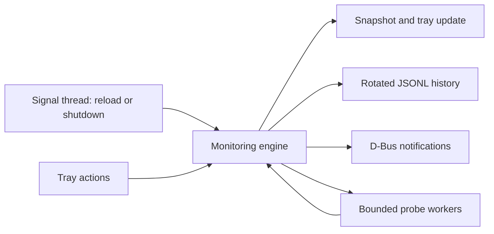

# SVMonitor design (V1)

This document describes V1 and notes where implemented v0.1.2 behavior differs from the initial sketch.

## Goals / non-goals
- Goal: tray + CLI monitor for Linux servers reachable through the user's existing OpenSSH setup. Idle RSS <= 20 MiB, ~0 CPU.
- Non-goals: remote agents, storing credentials, editing `~/.ssh/config`, Windows/macOS, graphs, remote control of servers.

## Findings that drove the design
| Finding | Consequence |
|---|---|
| Existing OpenSSH setup | Reuse keys, ssh-agent, Include, ProxyJump and known_hosts rather than implementing a second SSH client |
| A GNOME session may lack a StatusNotifierWatcher | Continue headless and attach when a tray host appears; GNOME needs an AppIndicator extension |
| A test VPS uses a Tailscale MagicDNS name | Keep Tailscale peer state separate from SSH reachability; never override host-key policy |
| tailscaled exposes a local status API | Read status over its Unix socket; tolerate missing/unreadable Tailscale |
| Distro glibc/toolchain versions differ | Build Debian packages inside Debian 12; use Rust >= 1.89 for the current lockfile |

## Architecture
The monitoring scheduler uses plain threads and an mpsc channel, without a Tokio runtime. Tray/D-Bus dependencies use async-io internally. The engine blocks until a command/result arrives or the next poll is due.

### Probing
- One `ssh` process per server per cycle; the remote script is POSIX `sh`, uses shell builtins (`read`) for `/proc`, one `df` fork. Read-only, no sudo, no agent.
- Flags added: `BatchMode=yes`, `ConnectTimeout`, `ServerAlive*`, `ClearAllForwardings=yes`, `ForwardAgent=no`, `ForwardX11=no`, `PermitLocalCommand=no`, `RemoteCommand=none`, `RequestTTY=no`. Host key checking, identities, ProxyJump, Include etc. come from the user's config untouched.
- Hard deadline enforced by killing the ssh process group.
- CPU% uses `/proc/stat` deltas; the first poll adds a one-second sampling window on the remote.

### Three independent dimensions (no false "offline")
1. **Tailscale**: `NotApplicable | LocalDown | PeerOnline | PeerOffline | Unmatched`.
2. **SSH**: `Unknown | Available | Unavailable(kind)`; kinds: Timeout, Refused, NoRoute, Reset, Dns, Auth, HostKey, Spawn, Other.
3. **Health**: thresholds (CPU/RAM/swap/disk/load), default 3-sample persistence and hysteresis.

Overall state: `Unknown | Online | Warning | Down | Attention | LocalIssue | Disabled`.
- Auth/HostKey/Dns/Spawn → `Attention` (never "offline").
- Connectivity failures count toward `Down` only when the local network (default route) and, for tailscale targets, local tailscaled are up; otherwise `LocalIssue` and nothing is alerted.
- Debounce: `failure_threshold` (default 3) consecutive failures, fast retry while pending; backoff while down.
- Suspend/resume detected via CLOCK_BOOTTIME − CLOCK_MONOTONIC drift → grace period, failures discarded, reprobe.

### Notifications
`org.freedesktop.Notifications` via zbus; per-server replace-id so a server never stacks toasts; per-(server,kind) cooldown; recovery only after a delivered down notice; nothing during `LocalIssue`/grace.

### Native tray presentation
StatusNotifierItem exposes cached static ARGB rack/status pixmaps at 16/22/32/48 px. DBusMenu keeps host-native layout, themed action icons and text fallback; no GUI runtime, animation or extra monitoring polls. Server navigation is urgency-sorted and bounded to eight entries per group, with disabled servers separate. Detailed metrics and recent history are nested. Tooltip text is bounded and markup-escaped; user labels escape DBusMenu mnemonic underscores. Tray callbacks enqueue engine commands rather than waiting for engine replies while the tray lock is held.

### Persistence
- Config `~/.config/svmonitor/config.toml` (atomic write). Servers refer to SSH aliases; optional manual host/user/port/identity.
- History `~/.local/state/svmonitor/{events,samples}.jsonl`, size-rotated.
- Runtime `state.json` in `$XDG_RUNTIME_DIR/svmonitor/` + flock single-instance lock.

### Why not…
- Tokio: not needed for the scheduler; tray/D-Bus still use a lightweight async-io executor internally.
- SQLite: extra C dependency; JSONL is enough for append + tail.
- libssh2/russh: would bypass ssh-agent/ProxyJump/Include/known_hosts semantics the product promises to reuse.
- GTK/Qt tray: heavy; SNI over D-Bus (ksni) is native to KDE/GNOME(extension)/others.

## Deviations from the first sketch (learned during implementation)
- The probe script is fed on stdin as `SVM_SAMPLE=<0|1>` + body; the first poll adds a 1 s `sleep` on the server to get a CPU % without waiting a full interval.
- systemd unit hardening is minimal: `ProtectSystem`/`ProtectHome`/`PrivateTmp` break ssh in a user manager (see SECURITY.md #11).
- `.deb` is built in a Debian 12 container; Arch package via `makepkg` from the local tree.
- `Outcome::Ok` and `ProbeResult::Ok` are boxed (large variant).
